<p align="center">
  
</p>

<p align="center">
  <a href="https://www.anypayx.com"></a>
  
  
  
</p>

<p align="center">
  <a href="https://www.anypayx.com">Website</a> ·
  <a href="https://www.anypayx.com/docs">Docs</a> ·
  <a href="https://api.anypayx.com/api">API</a> ·
  <a href="https://www.anypayx.com/walletbot">WalletBot</a> ·
  <a href="https://github.com/anypay/walletbot">WalletBot Core</a> ·
  <a href="https://github.com/anypay">GitHub</a>
</p>

---

## What It Is &amp; Purpose

**WalletBot Desktop** is a native cross-platform desktop application that provides a graphical user interface for [WalletBot](https://github.com/anypay/walletbot) — Anypay's self-custody headless wallet for automated cryptocurrency payments. Built with Electron, TypeScript, and Webpack, it brings the power of automated payment processing to desktop users who prefer a visual interface over command-line operations.

This application enables merchants and developers to manage their self-hosted payment automation workflows with the full security of local key storage, eliminating the need to trust third-party custody solutions while maintaining seamless integration with the Anypay invoice and payment platform.

WalletBot Desktop is currently in early development as an Electron boilerplate foundation, with the core automation engine planned for integration.

## Why Use It

**Desktop wallet automation** solves a critical challenge in cryptocurrency commerce: how to automatically process incoming payments while maintaining complete control over private keys. WalletBot Desktop brings this capability to users who prefer graphical interfaces.

- **Who it's for:** Merchants and developers who want automated payment processing with self-custody, power users who prefer desktop apps over CLI tools, and businesses managing high-volume cryptocurrency transactions across Bitcoin, Ethereum, and stablecoins (USDC, USDT, RLUSD, NUSD).
- **Where it fits:** WalletBot Desktop sits between the merchant's local environment and the Anypay platform. It monitors Anypay invoices, automatically signs transactions using locally stored private keys, broadcasts payments to blockchain networks, and updates invoice statuses — all without requiring keys to leave the user's machine. This makes it the self-custody automation layer for merchants who trust no one but themselves.

**Key advantages:**
- **Complete self-custody** — your keys never leave your desktop
- **Multi-chain support** — Bitcoin, Ethereum, Solana, XRP Ledger, and EVM chains
- **Native desktop experience** — cross-platform GUI for Windows, macOS, and Linux
- **Invoice automation** — watches Anypay invoices and pays them automatically
- **Local key management** — secure key storage with desktop OS integration

## How It Works

<p align="center">
  
</p>

WalletBot Desktop orchestrates a four-stage automated payment workflow:

1. **Desktop App** — The Electron-based GUI runs on Windows, macOS, or Linux, providing a visual dashboard for monitoring invoices, viewing transaction history, managing wallet configurations, and controlling automation rules. The interface communicates with the underlying WalletBot engine through a local IPC bridge.

2. **Local Keys** — Private keys are stored securely on the user's machine using OS-native secure storage (Keychain on macOS, Credential Manager on Windows, Secret Service on Linux). The desktop app never transmits keys over the network; all transaction signing happens locally within the Electron process.

3. **Anypay API** — The application polls the Anypay invoice API (`api.anypayx.com`) for new payment requests matching the configured wallet addresses. When an invoice is detected, WalletBot fetches payment details including recipient address, amount, currency, and any special instructions.

4. **Auto Payments** — Once an invoice is validated, WalletBot constructs the appropriate transaction for the target blockchain, signs it with the local private key, broadcasts it to the network, monitors for confirmation, and updates the invoice status on Anypay. This entire flow runs automatically without manual intervention.

The desktop wrapper ensures users can observe and control this automation through familiar GUI patterns — start/stop buttons, real-time logs, notification alerts, and configuration panels — while maintaining the security guarantees of local key custody.

## Quickstart / How to Use It

> **Note:** WalletBot Desktop is currently in early development. The commands below reflect the Electron boilerplate foundation. Full WalletBot integration is planned.

### Prerequisites

- **Node.js** 16.x or later
- **Yarn** or npm package manager
- One of: Windows 10+, macOS 10.13+, or a modern Linux distribution

### Installation &amp; Development

```bash
# Clone the repository
git clone https://github.com/anypay/wallet-bot-desktop.git
cd wallet-bot-desktop

# Install dependencies
yarn install

# Start the development server
yarn start
```

The desktop app will launch with hot-reload enabled. Any changes to TypeScript files in `src/` are automatically rebuilt.

### Building for Production

```bash
# Package the app for your platform
yarn package

# Build distributable installers
yarn make
```

Electron Forge generates platform-specific distributables:
- **Windows:** `.exe` installer (Squirrel) in `out/make/squirrel.windows/`
- **macOS:** `.zip` archive and `.dmg` installer in `out/make/`
- **Linux:** `.deb` and `.rpm` packages in `out/make/`

### Project Structure

```
wallet-bot-desktop/
├── src/
│   ├── index.ts         # Main Electron process
│   ├── renderer.ts      # Renderer process entry
│   ├── index.html       # Main window HTML
│   └── index.css        # Styles
├── webpack.*.config.js  # Webpack configurations
├── package.json         # Dependencies and scripts
└── tsconfig.json        # TypeScript config
```

### Configuration

WalletBot Desktop uses Electron Forge with Webpack for bundling. The main Electron process (`src/index.ts`) creates browser windows, while the renderer process (`src/renderer.ts`) handles UI logic. TypeScript compilation and hot-reload are configured through the Webpack plugin chain.

## Next Moves for Growth

WalletBot Desktop is an early-stage foundation awaiting integration with the core [WalletBot](https://github.com/anypay/walletbot) automation engine. High-leverage next steps grounded in the current state:

1. **Integrate WalletBot Core** — Embed `@anypay/walletbot` as a dependency and bridge the CLI interface to the Electron IPC layer. This is the critical path: without the core engine, the desktop shell has no payment automation to present.

2. **Implement Secure Key Storage** — Add OS-native keychain integration using `keytar` or `electron-store` with encryption. The current boilerplate has no key management; this is essential before handling real private keys.

3. **Build the Dashboard UI** — Replace the "Hello World" placeholder with a React or Vue-based dashboard showing invoice queues, transaction history, wallet balances, and automation status. The brand spec already defines the dark-mode palette (`#111111`, `#161C24`, `#00AB55`) for consistent Anypay styling.

4. **Add Multi-Chain Support** — Integrate wallet libraries for Bitcoin (via `bitcoinjs-lib`), Ethereum (`ethers.js`), Solana (`@solana/web3.js`), and XRP Ledger (`xrpl.js`). Each chain requires its own signer and broadcaster module.

5. **Implement Auto-Updater** — Configure `electron-updater` for seamless over-the-air updates. The Electron Forge config is already in place; adding the update server and release pipeline enables push updates without manual reinstalls.

6. **Write Integration Tests** — The project has no tests. Add Spectron or Playwright for end-to-end Electron testing, covering key flows like wallet import, invoice polling, and payment signing. Verify on all three platforms (Windows, macOS, Linux) before release.

7. **Publish to Package Repositories** — Once stable, distribute through Homebrew Cask (macOS), Chocolatey (Windows), Snap Store (Linux), and direct GitHub Releases. The `.deb` and `.rpm` makers are configured but never published.

8. **Document Wallet Setup Flow** — Write step-by-step guides for importing wallets, connecting to Anypay accounts, and configuring automation rules. The current README documents the developer setup but not the end-user experience.

9. **Add Logging &amp; Debugging** — Integrate `electron-log` for persistent logs and Sentry for crash reporting. Desktop apps need local logs that survive restarts; the browser console alone is insufficient.

10. **Align with Anypay Brand** — Update the app icon, window titles, and About dialog to use the official Anypay mark and green color scheme (`#00AB55`). The boilerplate defaults to Electron's icon and generic labels.

These steps build on verified facts: the existing Electron 20.0.3 / TypeScript 4.5.4 stack, the configured Webpack build chain, the relationship to `@anypay/walletbot`, and the gaps in the current boilerplate (no UI, no wallet code, no tests, no key storage).

## Anypay Ecosystem &amp; License

WalletBot Desktop is part of [Anypay](https://www.anypayx.com) — Bitcoin &amp; Stablecoin payments for business. Merchants and developers use Anypay to accept BTC, ETH, and stablecoins such as USDC, USDT, RLUSD, and NUSD through invoices, APIs, SDKs, webhooks, WooCommerce, and mobile POS.

| Project | Role |
| --- | --- |
| [walletbot](https://github.com/anypay/walletbot) | Self-custody headless wallet engine (`@anypay/walletbot`) — the core automation library |
| [anypay](https://github.com/anypay/anypay) | Invoice &amp; payments platform / API (`@anypay/server`) |
| [anypay-sdk](https://github.com/anypay/anypay-sdk) | TypeScript SDK for browser &amp; Node.js (`@anypay/client`) |
| [merchant-app](https://github.com/anypay/merchant-app) | iOS &amp; Android point-of-sale app — mobile counterpart to this desktop GUI |

**Related Desktop Tools:**
- [homebrew-anypay](https://github.com/anypay/homebrew-anypay) — Homebrew tap for macOS CLI installs
- [anypay-woocommerce](https://github.com/anypay/anypay-woocommerce) — WooCommerce plugin for WordPress e-commerce integration

### License

WalletBot Desktop is released under the **MIT License**. See the [`package.json`](package.json) `license` field for confirmation.

```text
MIT License

Copyright (c) Steven Zeiler

Permission is hereby granted, free of charge, to any person obtaining a copy
of this software and associated documentation files (the "Software"), to deal
in the Software without restriction, including without limitation the rights
to use, copy, modify, merge, publish, distribute, sublicense, and/or sell
copies of the Software, and to permit persons to whom the Software is
furnished to do so, subject to the following conditions:

The above copyright notice and this permission notice shall be included in all
copies or substantial portions of the Software.

THE SOFTWARE IS PROVIDED "AS IS", WITHOUT WARRANTY OF ANY KIND, EXPRESS OR
IMPLIED, INCLUDING BUT NOT LIMITED TO THE WARRANTIES OF MERCHANTABILITY,
FITNESS FOR A PARTICULAR PURPOSE AND NONINFRINGEMENT. IN NO EVENT SHALL THE
AUTHORS OR COPYRIGHT HOLDERS BE LIABLE FOR ANY CLAIM, DAMAGES OR OTHER
LIABILITY, WHETHER IN AN ACTION OF CONTRACT, TORT OR OTHERWISE, ARISING FROM,
OUT OF OR IN CONNECTION WITH THE SOFTWARE OR THE USE OR OTHER DEALINGS IN THE
SOFTWARE.
```

---

<p align="center">
  <a href="https://www.anypayx.com"></a><br/>
  <sub>Bitcoin &amp; Stablecoin Payments For Business · <a href="https://www.anypayx.com">anypayx.com</a> · <a href="https://x.com/xanypay">@xanypay</a></sub>
</p>
